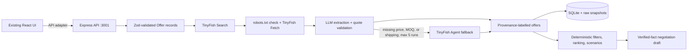

# VendorMind backend

TypeScript/Express API for the React frontend in `../frontend`. It runs on
port `3001` by default and keeps its code, dependencies, SQLite database,
fixtures, and research snapshots inside this directory.



The frontend uses the backend's provenance-aware research, evaluation,
scenario, and negotiation endpoints. Vite proxies `/api` to port 3001.

## Run locally

Requires Node.js 20 or newer.

```powershell
cd backend
npm install
if (!(Test-Path .env)) { Copy-Item .env.example .env }
npm run dev
```

The API is available at `http://localhost:3001`. Set `TINYFISH_API_KEY` in
`.env` to enable live supplier search and page research. Without credentials,
research returns conspicuously labelled synthetic fixtures so the comparison
and scenario workflow remains usable. A compatible OpenAI-style chat
completions provider can be configured using `LLM_BASE_URL`, `LLM_API_KEY`,
and `LLM_MODEL`; the deterministic, evidence-restricted negotiation drafter
works without a model.

The example configuration uses OpenRouter's free
`minimax/minimax-m3.1-flash:free` model, which supports the JSON response format
used by the backend. Free model availability and usage limits are set by
OpenRouter and may change. Create an OpenRouter API key and set `LLM_API_KEY` in
`backend/.env` to that key. Keep the key private; do not commit it or place it
in frontend configuration.

The backend reads `backend/.env` even if started from another directory. Restart
the backend after changing it. Check `http://localhost:3001/api/health`: a
working configuration shows `"tinyFishConfigured": true`. This only confirms
the key is loaded; a real search verifies whether the key and TinyFish service
work. Search only runs live for packaging and office/industrial products.
Engineering materials use sample fixtures, and unsupported categories return
an error. If TinyFish Search fails or no permitted supplier pages are found,
the API reports the failure instead of presenting sample data as search results.
Without `LLM_BASE_URL`, `LLM_API_KEY`, and `LLM_MODEL`, live pages can still be
found, but detailed price and shipping extraction remains incomplete. TinyFish
Agent fallback is disabled by default; enabling it may consume credits.

Live supplier searches target India by default. The buyer's delivery location
is passed with India to TinyFish Search, and likely Indian results are reviewed
first. Other public results remain as fallback. A `.in` domain or a search
snippet is only a ranking hint, not proof of where a supplier operates; check
the linked page and delivery terms before placing an order.

To build and run the production server:

```powershell
npm run build
npm start
```

## Deploy to Render

The repository includes a root-level `render.yaml` Blueprint for the backend.
In Render, create a new Blueprint Instance for this repository and deploy the
`vendormind-backend` web service. The service builds with `npm ci` and
`npm run build`, starts with `npm start`, and uses `/api/health` for health
checks. Render supplies the port through `PORT`.

The Blueprint mounts a persistent disk at `/var/data` and stores the SQLite
database and research snapshots there. Persistent disks require a paid Render
instance and are not available on the free plan. Set optional provider
credentials such as `TINYFISH_API_KEY` in the service's Render environment
settings. The Blueprint configures OpenRouter and a free model by default; add
your OpenRouter key as `LLM_API_KEY` in Render's environment settings. Never
commit `.env` or provider credentials to the repository.

## API integration guide (Member A + Member C)

This is the shared HTTP contract for connecting the frontend, integration, and
demo work. Start the backend and use `http://localhost:3001` as the base URL
(or the deployed backend URL). All routes are prefixed with `/api`; JSON
requests require `Content-Type: application/json`. Keep TinyFish and LLM keys
in the backend environment only; do not call those providers directly from the
browser.

The JavaScript examples below assume:

```js
const API_BASE = "http://localhost:3001";
```

### Shared data contract

Use one `brief` object and pass the `offers` returned by research unchanged to
evaluation, scenario, and negotiation endpoints. This preserves field-level
provenance and avoids losing the evidence needed by filters and draft checks.

```json
{
  "product": "corrugated shipping boxes",
  "quantity": 40,
  "budget": 500,
  "currency": "USD",
  "deadlineDays": 30,
  "mandatorySpecs": ["recyclable"],
  "priority": "cost",
  "region": "US"
}
```

`budget`, `deadlineDays`, and `region` may be `null`; `mandatorySpecs` may be
empty. Currency must be `USD`, `EUR`, `GBP`, or `INR`. Priority must be `cost`,
`speed`, or `balanced`. The research endpoint also accepts its brief fields at
the top level (`deadline_days` and `must_haves` are accepted aliases); for all
subsequent endpoints use the canonical camelCase `brief`.

An `Offer` is the complete object returned in `offers`, including
`offerId`, supplier/product fields, price and delivery fields, and
field-by-field `provenance`. Its canonical runtime contract is
[`src/schemas.ts`](./src/schemas.ts) (`OfferSchema` and
`PurchaseBriefSchema`). Do not convert an offer to the older frontend shape
before calling backend endpoints. `isFixture: true` means synthetic demo data,
not a live supplier quote.

### Endpoints

#### `GET /api/health`

No request body. Indicates that the server is responding and whether live
research and Agent fallback are configured.

```json
{
  "status": "ok",
  "tinyFishConfigured": true,
  "agentFallbackEnabled": true
}
```

#### `POST /api/research`

Starts supplier research and saves the resulting brief and offers. For
predictable integration/demo testing, set `fixtureOnly` to `true`; this avoids
network calls and returns clearly labelled fixtures. Live research supports
packaging and office/industrial supplies. Engineering materials are fixture
only in Round 1.

```json
{
  "brief": {
    "product": "corrugated shipping boxes",
    "quantity": 40,
    "budget": 500,
    "currency": "USD",
    "deadlineDays": 30,
    "mandatorySpecs": [],
    "priority": "cost",
    "region": null
  },
  "fixtureOnly": true
}
```

Response shape:

```json
{
  "briefId": "returned-uuid",
  "brief": {},
  "offers": [],
  "source": "fixture",
  "note": "Fixture-only research requested; no live supplier pages were visited.",
  "category": "packaging",
  "snapshots": 0
}
```

`source` is `fixture` or `tinyfish`. Store `briefId` and reuse it in the
scenario, negotiation, and brief-retrieval calls. A research request outside
the supported Round 1 categories returns `422`.

#### `POST /api/research/stream`

Same JSON request as `/api/research`, but returns POST-based Server-Sent Events
with content type `text/event-stream`. Events are named `progress`, `complete`,
or `error`; each event's `data` is JSON. The `complete` data has the same shape
as the normal research response. Use this route when the UI needs to display
research progress. With browser `fetch`, read `response.body` as a stream; the
native `EventSource` API does not support POST request bodies.

#### `POST /api/evaluate`

Evaluates supplied offers against the brief. Returns `briefId`, evaluation
`status`, `recommendation`, ranked/partial/excluded rows, a fallback, currency,
and the scoring formula. A result may be `ranked`,
`partial_estimate`, or `insufficient_evidence`.

```js
const evaluationResponse = await fetch(`${API_BASE}/api/evaluate`, {
  method: "POST",
  headers: { "Content-Type": "application/json" },
  body: JSON.stringify({
    briefId: research.briefId,
    brief: research.brief,
    offers: research.offers
  })
});
const evaluation = await evaluationResponse.json();
```

`offers` must be the complete array returned by research, not IDs or
transformed frontend objects. Passing the existing `briefId` avoids saving
the same offer IDs again.

#### `POST /api/scenario`

Runs a counterfactual evaluation and persists the scenario under the supplied
brief. `briefId` is optional; if provided, it must be an existing UUID.

```js
const scenarioResponse = await fetch(`${API_BASE}/api/scenario`, {
  method: "POST",
  headers: { "Content-Type": "application/json" },
  body: JSON.stringify({
    briefId: research.briefId,
    brief: research.brief,
    offers: research.offers,
    changes: {
      quantity: 60,
      deadlineDays: 45,
      priority: "balanced",
      discountsByOffer: {},
      shippingOverrides: {},
      selectedOfferId: research.offers[0].offerId
    }
  })
});
const scenario = await scenarioResponse.json();
```

`changes` supports optional `quantity`, `deadlineDays`, `priority`,
`discountsByOffer` (offer ID to discount percentage), `shippingOverrides`
(offer ID to shipping amount), and `selectedOfferId`. Defaults for the two
maps are empty. The response includes `scenarioId`, updated `evaluation`,
`fallback`, `breakEvenPoints`, `quantityRange`, and optional
`targetDiscount`/`savings`. Treat the target discount as a strategy, not a
prediction; savings are explicitly potential only.

#### `POST /api/negotiate`

Creates and persists a human-review-only negotiation draft. `supplierId` is
the selected offer's `offerId`, not its supplier name. `briefId` is optional
but, when provided, must identify a saved brief.

```js
const draftResponse = await fetch(`${API_BASE}/api/negotiate`, {
  method: "POST",
  headers: { "Content-Type": "application/json" },
  body: JSON.stringify({
    briefId: research.briefId,
    brief: research.brief,
    offers: research.offers,
    supplierId: research.offers[0].offerId
  })
});
const draft = await draftResponse.json();
```

The response contains `draftId`, `supplierId`, `supplierName`, `status`
(`ready` or `insufficient_evidence`), `draft`, `evidenceUsed`, `numberCheck`,
`provider`, `note`, and `approvalStatus`. Insufficient evidence may produce a
draft that asks the supplier to confirm missing terms. No message is sent.

#### `POST /api/negotiate/approve`

Records the user's approval for a saved draft. It does not send the draft.

```json
{
  "draftId": "draft-uuid-from-negotiate",
  "approved": true
}
```

Call only after an explicit user approval action:

```js
const approvalResponse = await fetch(`${API_BASE}/api/negotiate/approve`, {
  method: "POST",
  headers: { "Content-Type": "application/json" },
  body: JSON.stringify({ draftId: draft.draftId, approved: true })
});
const approval = await approvalResponse.json();
```

Response:

```json
{
  "draftId": "draft-uuid-from-negotiate",
  "approvalStatus": "approved",
  "sent": false,
  "message": "Approval recorded. No message was sent."
}
```

#### `GET /api/briefs/:briefId`

Retrieves the saved brief and its offers, scenarios, drafts, and draft
approval state. Replace `:briefId` with the UUID returned by research or
evaluation. Invalid or unknown IDs return `404`.

```js
const savedResponse = await fetch(
  `${API_BASE}/api/briefs/${research.briefId}`
);
const savedBrief = await savedResponse.json();
```

### Suggested integration sequence

1. Call `GET /api/health` to confirm the backend is available.
2. Call `POST /api/research` (use `fixtureOnly: true` for the demo) and keep
   the returned `brief`, `offers`, and `briefId` in application state.
3. Display research offers and source/evidence labels. Keep `isFixture` and
   `provenance` visible so users can distinguish demo data from verified
   supplier facts.
4. Call `POST /api/evaluate` with that exact `brief` and `offers` to populate
   the comparison results.
5. Call `POST /api/scenario` when the user changes quantity, deadline,
   priority, discount, shipping, or selected offer; use the same `briefId`.
6. Call `POST /api/negotiate` for a selected offer and show the returned draft
   for human review. Only call `/api/negotiate/approve` after an explicit
   approval action.
7. Call `GET /api/briefs/:briefId` to reload the saved workflow after a page
   refresh.

Use this same API contract across Member A and Member C's frontend/integration
work; do not create a second frontend-side ranking or negotiation contract
that discards the backend evidence data.

### Errors and browser connection

JSON API errors use `{ "error": "message" }`; validation errors (`400`) may
also include a `details` array. Common statuses are `400` for invalid JSON or
fields, `404` for unknown brief/draft IDs or routes, `422` for unsupported
research categories, and `500` for unexpected server errors. The streaming
route reports runtime failures as an `error` SSE event with `status` and
`message` fields.

The API currently does not enable cross-origin browser requests. When the
frontend and backend use different origins/ports, connect them through a
same-origin development proxy or configure a restricted CORS allow-list for
the frontend origin before calling the API directly from browser code.

Every offer carries field-level provenance (`value`, `sourceUrl`,
`retrievedAt`, `status`, `extractionMethod`). Fixture records have no
fabricated supplier URL and are always marked `isFixture: true`. Unknown
shipping, specifications, MOQ, and delivery are not treated as passes. Totals
are partial when shipping is unknown; currencies are never silently converted.
Cached raw TinyFish responses are stored under `snapshots/` with timestamps.

## Data and safety

SQLite is initialized automatically at `DATABASE_PATH`; `drizzle-orm` is used
for typed persistence. The service never sends supplier emails or makes
purchases. LLM output is constrained to a verified evidence bundle and is
rejected if it introduces unsupported amounts or supplier identities. API
keys belong only in the ignored `.env` file. This prototype has no user
authentication; keep the API on a trusted local network and do not expose it
directly to the public internet.

## Verification

```powershell
npm test
npm run build
```
